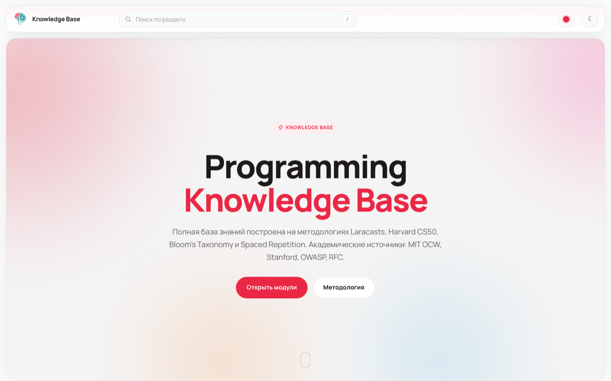
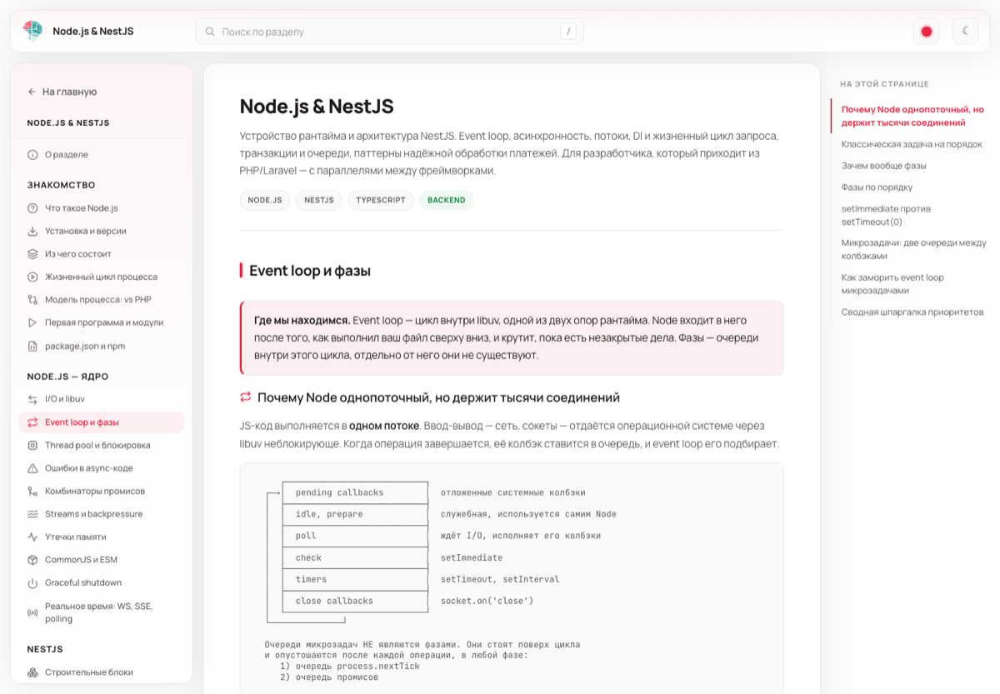

# Programming Knowledge Base

База знаний по backend-разработке: PHP и Laravel, SQL, безопасность, архитектура, тестирование, инфраструктура, плюс фронтенд-минимум и Node.js. Уровень middle/senior. Сделана как Laravel-приложение: каждый раздел — отдельная страница с боковой навигацией, поиском и тёмной темой.

Живая версия: **[zh-photgraphy.asia](https://zh-photgraphy.asia)**

## Главная

<p align="center">
  
</p>

## Страница раздела

<p align="center">
  
</p>

## Содержание

| # | Раздел | Темы |
|---|---|---|
| KB_1 | PHP Core | Типы, ООП, traits, интерфейсы, магические методы, namespaces, PHP 8.x, генераторы, closures |
| KB_2 | SQL и базы данных | Реляционная модель, нормализация, JOIN-семантика, индексы (B-Tree, GIN, covering, leftmost), EXPLAIN, N+1, ACID, MVCC, deadlock, оконные функции и CTE, MySQL против PostgreSQL, PDO |
| KB_3 | Laravel | Request Lifecycle, Routing со scoped bindings, Middleware и terminate, FormRequest, Eloquent, Cache с блокировками, Queues (retry, идемпотентность, afterCommit), Events, Scheduler, Auth/Gates/Policies, Octane |
| KB_4 | Безопасность | OWASP Top 10, пароли (bcrypt, argon2), JWT и Sanctum, OAuth 2.0 + PKCE, RBAC/ABAC, CSRF, XSS, SQL-инъекции, CORS, rate limiting, HTTPS и TLS |
| KB_5 | Архитектура и паттерны | SOLID, паттерны GoF (Factory, Strategy, Observer, Decorator, Adapter), Repository, Service Layer, DTO, DDD, Clean Architecture |
| KB_6 | Тестирование и DevOps | PHPUnit и Pest, unit- и feature-тесты, TDD, Docker и Docker Compose, Git workflow, CI/CD, Nginx, деплой |
| KB_9 | Наследование и базовые классы | Что именно наследуют Controller, Model, FormRequest, Middleware, Job, Command, Notification, Mailable |
| KB_10 | Хелперы и методы | Справочник: request и validation, Eloquent, Collections, Str, Arr, Carbon, session, auth, routing, debug, artisan |
| KB_11 | Cloud и DevOps: сети | Виртуализация и гипервизоры, типы сетей, OSI и TCP/IP, MAC, IPv4 и IPv6, ARP, TCP, UDP, ICMP, порты, подсети и CIDR, NAT, VLAN |
| KB_12 | Eloquent Advanced | Все виды связей, включая polymorphic и hasManyThrough, кастомные касты, observers, race conditions, chunk против cursor и lazy |
| KB_13 | Service Container и DI | Виды привязок, contextual, tagged, autowiring, Service Providers, deferred и package-провайдеры |
| KB_14 | Тестирование: глубоко | Test doubles по Мезаросу, дизайн тестов, пирамида и трофей, стратегии работы с БД, параллельный запуск, mutation testing, coverage |
| KB_16 | JavaScript и jQuery | Типы и var/let/const, scope и замыкания, точечная и скобочная нотация, `==` против `===`, функции и стрелки, массивы, объекты, DOM, события, Promise и async/await, fetch, интеграция с PHP и Laravel |
| KB_17 | Vue.js | Vue 3: Options и Composition API, реактивность (ref, reactive, computed, watch), директивы, компоненты, события, роутер |
| KB_18 | Nginx и Docker | Nginx: установка, структура файлов, server blocks, location, PHP-FPM, TLS, rate limiting, кэш, reverse proxy. Docker: образы, тома, сети, compose |
| KB_19 | Python | Python 3.11+ для backend-разработчика на PHP: синтаксис, типы, ООП, модули, виртуальные окружения, веб-фреймворки, мосты Python ↔ PHP |
| KB_20 | CLI: Bash, Git, Composer | Bash: навигация, grep и find, процессы, права, пайпы. Git: от init до push, три состояния, ветки, отмена изменений. Composer: зависимости, lock, версии, автозагрузка |
| KB_21 | Node.js и NestJS | Жизненный цикл процесса, I/O и libuv, event loop и фазы, thread pool, ошибки в async-коде, потоки и backpressure, утечки памяти, CommonJS и ESM, graceful shutdown, WebSocket/SSE/polling. NestJS: модули и провайдеры, жизненный цикл запроса, DI и scope, DTO и guards, ORM и транзакции, очереди, тестирование |
| KB_22 | React, TypeScript, Tailwind | JSX и согласование, хуки и зависимости, причины перерисовок, где хранить состояние, загрузка данных. TypeScript: tsconfig и strict, дженерики, утилитарные типы, сужение, размеченные объединения. Tailwind: токены, адаптив, тёмная тема, организация классов |

Плюс страницы «Программа и расписание» и «Дневное расписание» — roadmap по фазам и план занятий с интервальным повторением.

> Часть разделов рабочие и в репозиторий не выкладывается — они перечислены в `.gitignore`.

## Возможности интерфейса

- **Поиск по всей базе** — подсказки по модулям и разделам, стрелки и Enter для перехода, `/` для фокуса. Переход внутри страницы переключает раздел без перезагрузки, на другой модуль — ссылкой вида `/KB_21_NodeJS_NestJS#sec-io`.
- **Тёмная тема** и **переключатель акцента** (красный или сине-зелёный). Выбор запоминается и применяется до первой отрисовки, поэтому страница не мигает при загрузке.
- **Боковая навигация** по разделам модуля и правый бар с подразделами текущего раздела, с подсветкой при прокрутке.
- **Мобильная версия**: навигация убирается в выдвижную панель.
- **PWA**: манифест и иконки, включая отдельные maskable-версии.

## Стек

- **PHP 8.3**, **Laravel 13**
- **SQLite** локально, MySQL на проде
- **Blade** для страниц, без сборщика фронтенда
- **Lucide Icons** через CDN
- Шрифты: **Manrope** для текста, **JetBrains Mono** для кода и схем — моноширинный с кириллицей, иначе ASCII-схемы разъезжаются
- Единая тема в `public/css/kb.css`, поведение в `public/js/kb.js`

## Запуск локально

```bash
cd kb-backend
composer install
cp .env.example .env
php artisan key:generate
touch database/database.sqlite
php artisan migrate --seed
php artisan kb:search-index      # собрать индекс для поиска
php artisan serve
```

Открыть [http://127.0.0.1:8000](http://127.0.0.1:8000).

## Команды

| Команда | Что делает |
|---|---|
| `php artisan db:seed --class=KbPagesSeeder` | Регистрирует модули: slug, заголовок, описание, иконка, layout |
| `php artisan kb:search-index` | Собирает `public/search-index.json` из пунктов меню в blade-файлах |
| `php artisan view:clear` | Сбрасывает скомпилированные blade-шаблоны |

Индекс поиска нужно пересобирать после добавления разделов — иначе новые не будут находиться.

## Структура

```
kb-backend/
├── app/
│   ├── Console/Commands/
│   │   └── BuildSearchIndex.php   # artisan kb:search-index
│   ├── Http/Controllers/          # KbPageController — один на все разделы
│   └── Models/Module.php
├── database/
│   ├── migrations/                # таблица modules
│   └── seeders/KbPagesSeeder.php  # метаданные страниц
├── public/
│   ├── css/kb.css                 # тема: светлая и тёмная, два акцента
│   ├── js/kb.js                   # плашка, поиск, темы, правый бар
│   ├── img/                       # логотип в светлом и тёмном варианте
│   └── search-index.json          # генерируется командой
├── resources/views/kb/            # по одному blade на раздел
└── routes/web.php                 # маршруты по slug
```

## Как это устроено

- **Один контроллер на все разделы.** Slug из URL → запись `Module` → blade-view из поля `file`.
- **Метаданные в БД** — заголовок, описание, badge, иконка, layout. Главная строит карточки из таблицы `modules`.
- **Два layout**: `sidebar` — боковое меню плюс контент, `fullwidth` — контент во всю ширину.
- **Общая тема поверх страниц.** `kb.css` подключается после собственных стилей страницы и переопределяет их через одинаковые имена CSS-переменных, поэтому вид у всех разделов единый без правки каждого файла.
- **Чистые URL**, старые `.html` отдают 301.

## Методология

Разделы построены по доказательным методикам обучения:

- **Bloom's Taxonomy** — от «помню» к «создаю»;
- **Active Recall** — вопросники для самопроверки со скрытыми ответами;
- **Spaced Repetition** — нарастающие интервалы повторения;
- **Project-Based Learning** — практические задания.

Внутри подраздела обычно четыре блока: назначение, перечень компонентов, практика на примере, подводные камни. Материал сверяется с официальной документацией, а не пишется по памяти.

## Лицензия

Личный проект, MIT.
